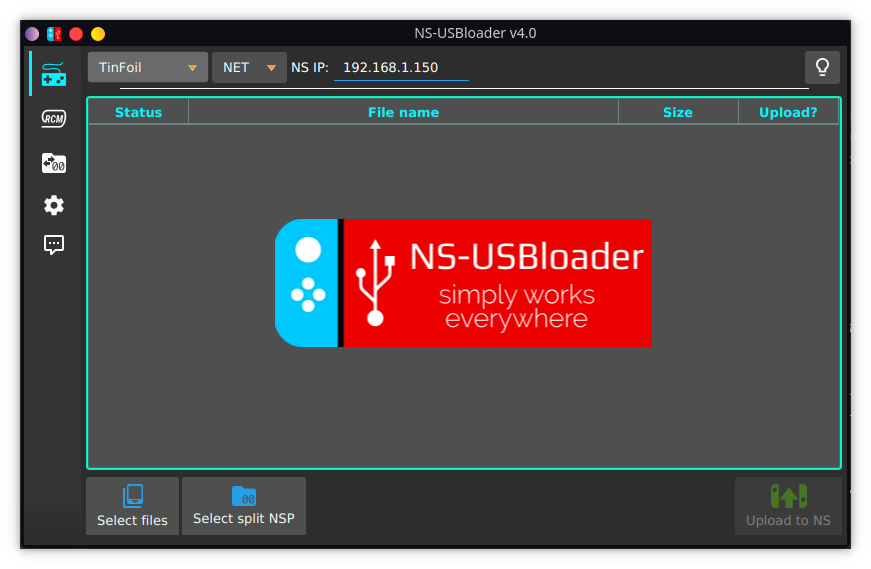
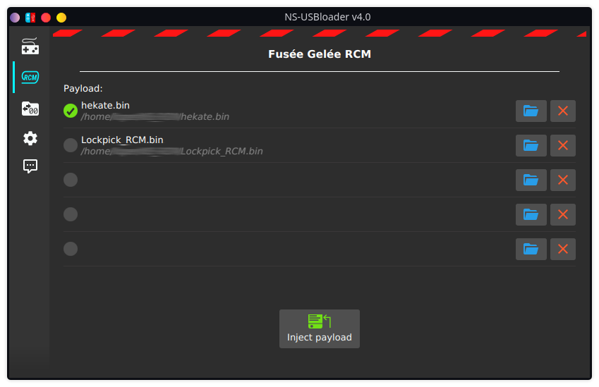
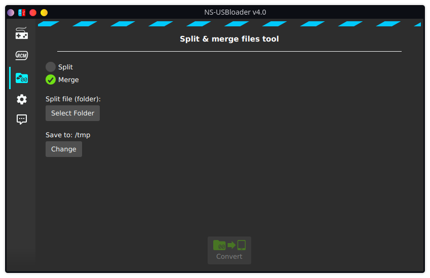
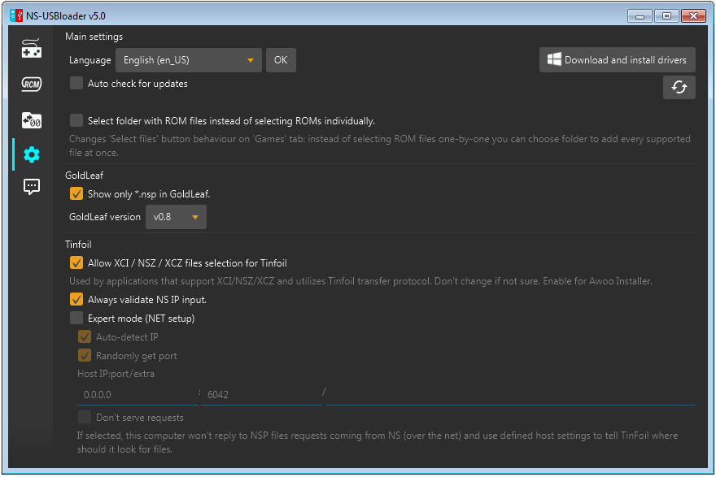
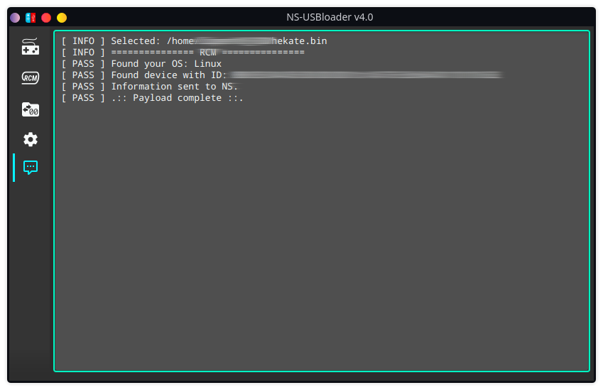

<h1 align="center"></h1>

   [](https://ci.redrise.ru/repos/12) [](https://repology.org/project/ns-usbloader/versions)

NS-USBloader is:
* A PC-side installer for **[Huntereb/Awoo-Installer](https://github.com/Huntereb/Awoo-Installer)** / other compatible installers (USB and Network supported) and **[XorTroll/Goldleaf](https://github.com/XorTroll/Goldleaf)** (USB) NSP installer. 
Alternative to default **usb_install_pc.py**, **remote_install_pc.py**, **GoldTree**/**Quark**. 
* RCM payload tool that works on Windows, macOS (Intel and Apple Silicon) and Linux (x86, amd64 and Raspberry Pi ARM).
* It's a tool for creating split files! 
* Also, you can use it for merging split files into one :)


[Click here for Android version ;)](https://github.com/developersu/ns-usbloader-mobile)

With a GUI and cookies. Works on Windows, macOS and Linux.
### Resources & links:
#### [→ Independent source code storage](https://git.redrise.ru/desu/ns-usbloader)
#### [→ Mirror, issues tracker, place to send PRs](https://github.com/developersu/ns-usbloader)
#### [→ Nightly builds](https://redrise.ru/builds/ns-usbloader/)

[Support/Donate](#support-this-app)

Sometimes I add new posts about this project [on my blog page](https://developersu.blogspot.com/search/label/NS-USBloader).

    
    


#### License

[GNU General Public License version 3](https://github.com/developersu/ns-usbloader/blob/master/LICENSE), or (at your option) any later version.

#### Used libraries & resources
* [OpenJFX](https://wiki.openjdk.java.net/display/OpenJFX/Main)
* [usb4java](https://mvnrepository.com/artifact/org.usb4java/usb4java)
* A few icons taken from: [materialdesignicons.com](http://materialdesignicons.com/)
* Information, ideas and data from the ['fusee-launcher'](https://github.com/reswitched/fusee-launcher) application
* [Apache Commons CLI](https://commons.apache.org/proper/commons-cli/)

### List of awesome code contributors, translators and other great people!

* [Pablo Curiel (DarkMatterCore)](https://github.com/DarkMatterCore)
* [wolfposd](https://github.com/wolfposd)
* [agungrbudiman](https://github.com/agungrbudiman)
* Perfect algorithms and great examples from the [mrdude2478/IPS_Patch_Creator](https://github.com/mrdude2478/IPS_Patch_Creator/)

* French by [Stephane Meden (JackFromNice)](https://github.com/JackFromNice) 
* Italian by [unbranched](https://github.com/unbranched)
* Korean by [DDinghoya](https://github.com/DDinghoya)
* Portuguese by [almircanella](https://github.com/almircanella)
* Spanish by [/u/cokimaya007](https://www.reddit.com/u/cokimaya007), [Kuziel Alejandro](https://github.com/Uzi-Oni)
* Chinese (Simplified) by [Huang YunKun (htynkn)](https://github.com/htynkn), [FFT9 (XXgame Group)](http://xxgame.net/)
* Chinese (Traditional) by [qazrfv1234](https://github.com/qazrfv1234), [FFT9 (XXgame Group)](http://xxgame.net/)
* German by [Swarsele](https://github.com/Swarsele)
* Vietnamese by [Hai Phan Nguyen (pnghai)](https://github.com/pnghai)
* Czech by [Spenaat](https://github.com/spenaat)
* Arabic by [eslamabdel](https://github.com/eslamabdel)
* Romanian by [Călin Ilie](https://github.com/calini)
* Swedish by [Daniel Nylander](https://github.com/yeager)
* Japanese by [kuragehime](https://github.com/kuragehimekurara1)
* Ryukyuan languages by [kuragehime](https://github.com/kuragehimekurara1)
* Turkish language by [Erimsaholut](https://github.com/Erimsaholut), [batuhanmeral](https://github.com/batuhanmeral)
* Serbian (Latin) translation [BlytheScythe](https://github.com/BlytheScythe)
* Catalan translation [segured928](https://github.com/segured928)

* Angelo Elias Dalzotto makes packages in AUR
* Phoenix[Msc] provides his shiny Mac M1 for debugging

### System requirements

- JDK 23 for macOS and Linux
- On macOS, if it doesn't work (but this should be fixed already), you'll need libusb: `brew install libusb`

### Supported Goldleaf versions
| Goldleaf version | NS-USBloader version |
|------------------|----------------------|
| v0.5             | v0.4 - v0.5.2, v0.8+ |
| v0.6             | none                 |
| v0.6.1           | v0.6                 |
| v0.7 - 0.7.3     | v0.7+                |
| v0.8 - 0.9       | v1.0+                |
| v0.10 - 1.0.0    | v6.0+                |
| v1.1.0 - 1.1.1   | none                 |
| v1.2.0+          | v6.0+                |

where '+' means 'any subsequent/later NS-USBloader version'.

### Awoo Installer and compatible applications support

Awoo Installer uses the same command-set (or 'protocol') as [Adubbz/Tinfoil](https://github.com/Adubbz/Tinfoil/).

A lot of other forks/apps use the same command-set. To stop speculating about the name, it's now called 'Awoo' (was 'Tinfoil')

### Usage
##### Linux:

1. Install JRE/JDK 23 or higher (openJDK for instance). JavaFX is not needed since it's embedded.

2. `root # java -jar /path/to/NS-USBloader.jar`

3. Optional: add user to the 'udev' rules so NS-USBloader can be run without root.
```
root # vim /etc/udev/rules.d/99-NS.rules
SUBSYSTEM=="usb", ATTRS{idVendor}=="057e", ATTRS{idProduct}=="3000", MODE="0666"
root # udevadm control --reload-rules && udevadm trigger
```
4. For the RCM part
```
root # vim /etc/udev/rules.d/99-NS-RCM.rules
SUBSYSTEM=="usb", ATTRS{idVendor}=="0955", ATTRS{idProduct}=="7321", MODE="0666"
root # udevadm control --reload-rules && udevadm trigger
```

5. For HiDPI, change font size in 'Settings' or use scaling like `java -Dglass.gtk.uiScale=150% -jar application.jar` 

##### Raspberry Pi

1. Install JDK: `sudo apt install default-jdk`
2. For the UI, install JavaFX: `sudo apt install openjfx`
3. See steps 3 and 4 from the 'Linux' section to add 'udev' rules.

##### macOS

1. Double-click on the downloaded .jar file. Follow instructions. Or see the 'Linux' section.
2. Set 'Security & Privacy' settings if needed.

##### macOS on Apple Silicon (ARM)

Download the `-mac+linux-aarch64.jar` build.

Manually install libusb with Homebrew by running `brew install libusb` in your Terminal.

##### Windows: 

* Once the application opens, click on the 'Gear' icon. 
* Click 'Download and install drivers'
* Install drivers

#### And how to use it?

The first thing you should do is install Awoo ([Huntereb](https://github.com/Huntereb/Awoo-Installer)) or Goldleaf ([XorTroll](https://github.com/XorTroll/Goldleaf)) on your NS. 

Take a look at the app, find the option to install from USB and/or Network. Maybe this (very old) [article about Tinfoil](https://developersu.blogspot.com/2019/02/ns-usbloader-en.html) will be helpful.

#### In detail

There are three tabs. The first one is the main one.

##### 'Gamepad' tab.

At the top, you select the application and protocol from a drop-down menu. For Goldleaf, only USB is available. The lamp icon switches between light and dark themes.

You can drag and drop files (split files, i.e. folders) into the application, or use the "Select NSP files" button. Multiple selection is available. Click the button again and select files from another folder if you want to add more — they will be added to the table.

In the table, you can check the boxes for the files you want to send to the application (Awoo or Goldleaf). You can also use the space bar to select/unselect files, and the Delete button to remove them. Right-clicking opens a context menu where you can delete a single item or all items.

For Goldleaf v0.6.1 and NS-USBloader v0.6 (and higher) you will have to use 'Explore content' -> 'Remote PC (via USB)'. You will see two drives `HOME:/` and `VIRT:/`. The first drive points to your home directory. The second one is a reflection of what you've added to the table (first application tab). Also, the `VIRT:/` drive has limited functionality in comparison to `HOME:/`. E.g., you can't write files to this drive since it's not a drive. But don't worry, it won't have any impact on Goldleaf or your NS if you try.

Also, to write files with Goldleaf (from NS to PC): You have to 'Stop execution' properly before accessing files transferred from GL. Usually you have to wait 5 seconds or less. It will guarantee that your files are properly written to the PC.

##### 'RCM' tab

On this tab you can select a payload, like Hekate or LockPick_RCM and send it to the NS. Drag-n-drop is supported. Also, some in-app validations of the payload take place ;)

##### 'Folder with arrows and zeroes' tab

On this tab you can split and merge files. Select 'Split' or 'Merge' and split/merge. BTW, Drag-n-drop is supported (except for the Windows .exe)

##### 'Gears' tab.

Here you can configure settings for network file transmission. Usually you shouldn't change anything. But if you're a cool hacker, go ahead! The most interesting option here is 'Don't serve requests'. The architecture of the Awoo's NET part works in an interesting way. When you select Awoo network transfer, the application will wait on port 2000 for information about where it should take files from. Like '192.168.1.5:6060/my file.nsp'. Usually NS-USBloader serves requests by implementing a simplified HTTP server, bringing it up, and so on. But if this option is selected, you can define the path to the remote location of the files. For example, if you set '192.168.4.2:80/ROMS/NS/' in settings and add the file 'my file.nsp' to the table then NS-USBloader will simply tell Awoo "Hey, go take files from '192.168.4.2:80/ROMS/NS/my%20file.nsp' ". Of course, you have to bring up the '192.168.4.2' host and make the file accessible from such address (just go install nginx).

Also, here you can:
* Set 'Auto-check for updates' to check for updates when the application starts. Or click the button to immediately verify if a new version has been released.
* Set 'Show only *.nsp in Goldleaf' to filter all files displayed on the HOME:/ drive. So only NSP files will appear.

##### 'Dialog with three dots' tab.

That's where all logs are dropped. Verbose information about transmissions comes here.

##### CLI (command line interface)

To get help, run ``$ java -jar ns-usbloader-4.0.jar --help``

```
 -c,--clean                      Remove/reset settings and exit
 -g,--Goldleaf <...>             Install via Goldleaf mode. Check '-g help' for information.
 -h,--help                       Show this help
 -m,--merge <...>                Merge files. Check '-m help' for information.
 -n,--tfn <...>                  Install via Awoo Network mode. Check '-n help' for information.
 -r,--rcm <[PATH/]payload.bin>   Send payload
 -s,--split <...>                Split files. Check '-s help' for information.
 -t,--tinfoil <FILE...>          Install via Awoo USB mode.
 -v,--version                    Show application version
```

For help with more complex commands, use the help argument after the first key. For example: 

```
$ java -jar ns-usbloader-4.0.jar -n help

Usage:
        ns-usbloader -n nsip=<arg1> [hostip=<arg2>] FILE1 ...
        ns-usbloader --tfn nsip=<arg1> [hostip=<arg2>] FILE1 ...

Options:
        nsip=<ip>               Define NS IP address (mandatory)
        hostip=<ip[:port]>      Define this host IP address. Will be obtained automatically if not set.
```

Usage examples:

```
Send RCM payload:
$ java -jar ns-usbloader-4.0.jar -r C:\Users\Superhero\hekate.bin
Send files to Awoo Installer via Net-install: 
$ java -jar ns-usbloader-4.0.jar -n nsip=192.168.0.1 ./file.nsz ./file.nsp ~/*.xci
Send files to Goldleaf v0.8:
$ java -jar ns-usbloader-4.0.jar -g ver=v0.8 ./*
Split files:
$ java -jar ns-usbloader-4.0.jar -s /tmp/ ~/*.nsp
Merge files:
$ java -jar ns-usbloader-4.0.jar -m /tmp/ ~/*.nsp
```

### Other notes

'Status' = 'Uploaded', appearing in the table, does not mean that the file has been installed. It means that it has been sent to the NS without any issues! That's what this app is about. 
Handling successful/failed installation is the purpose of the other side application: Awoo/Awoo-like or Goldleaf. And they don't provide any feedback interfaces, so I can't detect success/failure.

#### What is this '-legacy' jar?!

**JAR with no suffix** is recommended for Windows users, Linux users and macOS users who're using Mojave or later versions.

**JAR with '-legacy' suffix** is for macOS users who're still using OS X releases before Mojave.
(It also works for Linux and for Windows, but sometimes it doesn't work for Windows and I don't know why).

We have this situation because of weird behavior inside the usb4java library used in this application for USB interactions. In the '-legacy' version it's v1.2.0 and in the 'normal' version it's v1.3.0 with custom [libusb4java](https://github.com/developersu/libusb4java)

### Translators!

If you want to see this app translated to your language, go grab [this file](https://github.com/developersu/ns-usbloader/blob/master/src/main/resources/locale.properties) and translate it.

If you're familiar with pull requests, go ahead and create one! No worries if you are not. Just upload it somewhere (like pastebin/google drive/whatever else). [Create a new issue](https://github.com/developersu/ns-usbloader/issues) and post a link. I'll grab it and add it.

## Support this app

If you like this app, just give it a star on GitHub

This is a non-commercial project.

Card payments in case you want to donate: https://boosty.to/developersu/donate

Thanks!

Appreciate assistance and support of both [Vitaliy](https://github.com/SebastianUA) and [Konstantin](https://github.com/konstantin-kelemen). Without you, all this magic would not have happened.
